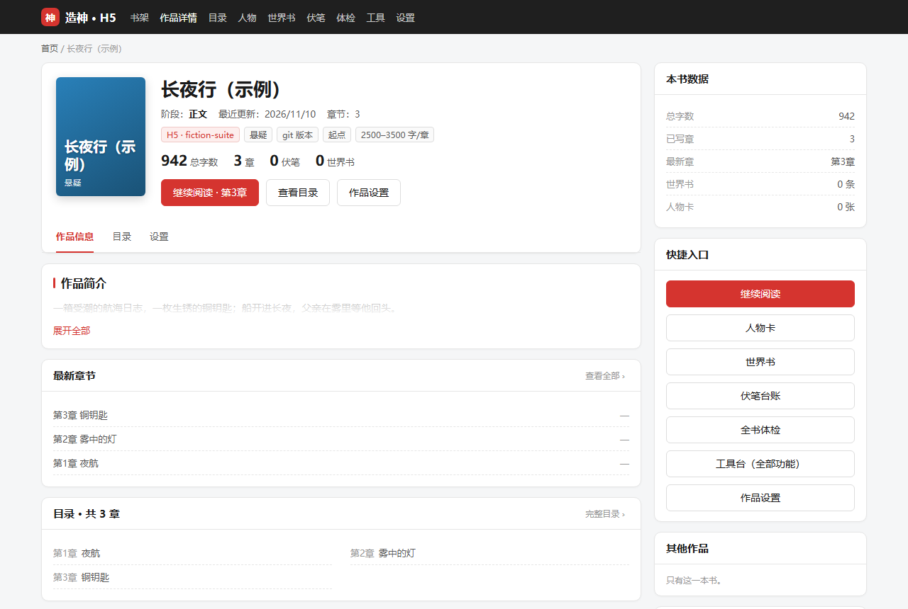
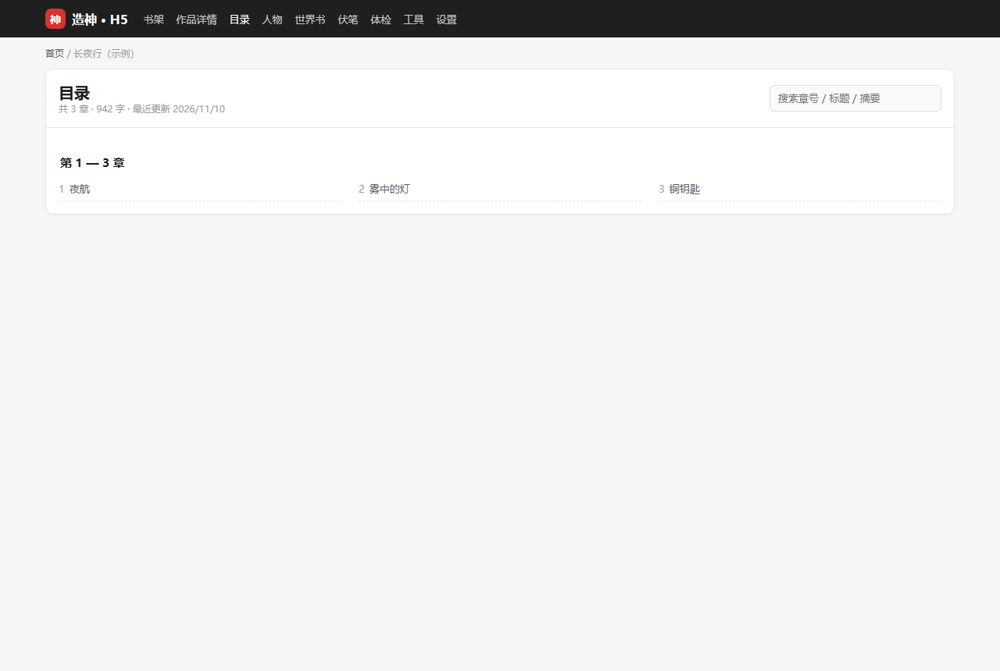
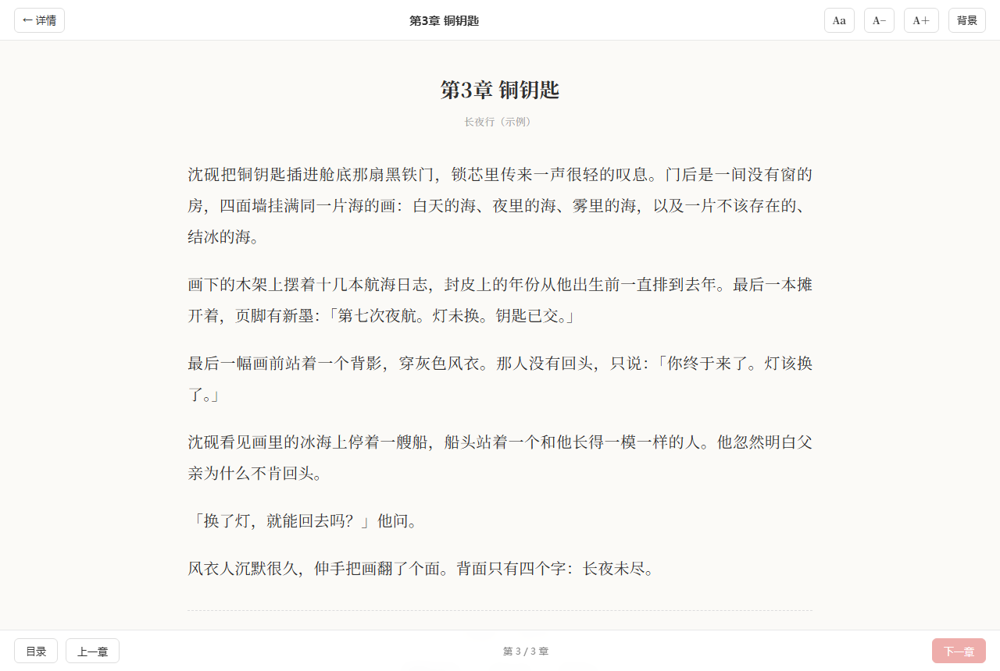
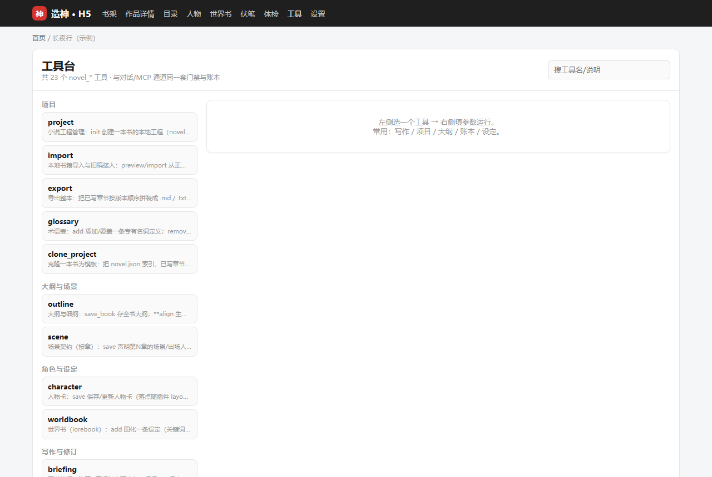
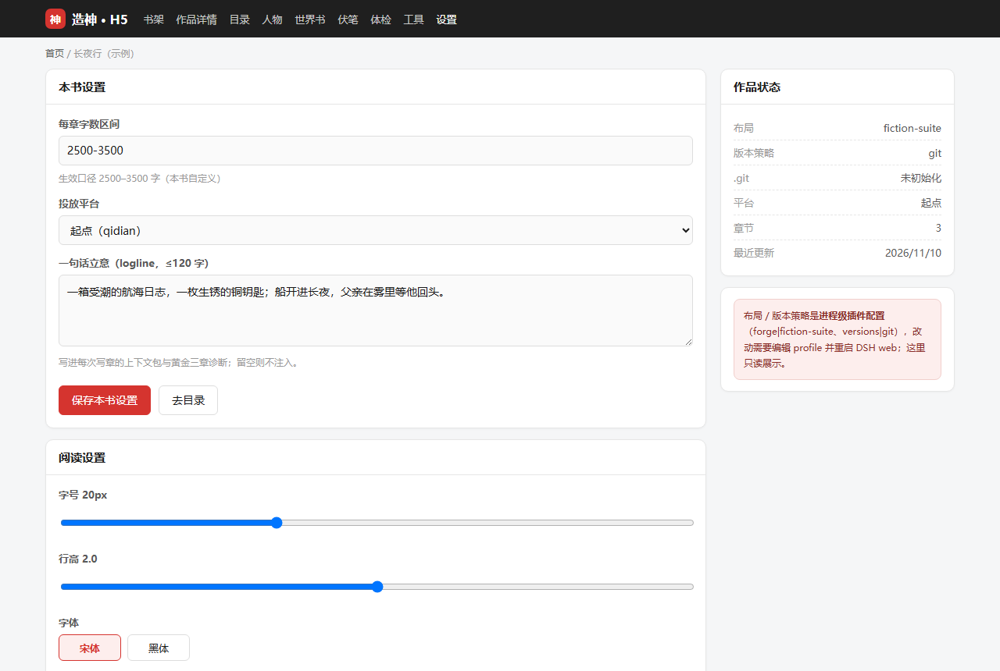

# DSH-web-novel · 造神

> 中文文档 ｜ [English](./README.en.md)

  [](https://github.com/Sukorinxu/DSH-web-novel/actions/workflows/ci.yml)

DeepSeek Harness（DSH）的中文长篇写作插件。它不是「提示词合集」，而是把**一致性、门禁、审计**做进工具层与数据层：模型负责动笔，插件负责把写坏、写歪、写穿的地方拦在落盘之前。

**适合谁：** 多角色 / 多卷 / 连载几十上百章、会被「设定崩了」「前文失忆」「悬念泄底」「AI 味太重」卡住的长篇作者。

**一句话卖点：** 关键约束全部代码化——同章改值=冲突拒绝、隐藏人物不进上下文、细纲漏写场景=拒稿、旧版永不覆盖、长篇检索零依赖本地跑。

[快速开始](#快速开始约-5-分钟) ｜ [界面一览](#界面一览) ｜ [功能硬约束表](#ai-写作通病与硬约束) ｜ [24 个工具](#24-个工具)

## 为什么不是又一个「提示词合集」

多数写作插件的约束写在系统提示里——模型心情好就守，赶进度就绕。本插件的设计主线只有一条：

> **代码强制 > 提示词自觉。** 凡是「靠模型自觉」的约束都会失效；一致性、门禁、审计必须是工具层/数据层的硬约束。

三条可在仓库里对着源码核的事实：

1. **三条入口共用一份判定链**：面板「💾 保存」、`novel_write_chapter`、REST 写入走同一套门禁代码（机审/账本冲突/内容门禁/细纲契约）——没有旁路；唯一的放行开关显式记审计。
2. **模型无法自批提案**：修订提案模型只能登记、不能应用——「应用」是面板里用户的主权动作（模型侧没有 apply 工具）；细纲批准记录批准通道，看板统计「工具自批占比」（真机实证某连载本曾 168/168 全自批，正是大纲漂移的第一缺口）。
3. **审计零 token**：机审、去 AI 味扫描、平台审稿、一致性校验、账本时点推演全部是纯本地计算——逐章审计成本为 0，数字不经过模型之手。

[](https://star-history.com/#Sukorinxu/DSH-web-novel&Date)

## FUSION 融合版（本仓库改造：引擎 × 用户技能）

本仓库是「造神」的本地改造版，把插件定位成**机械引擎**，把创作方法论交给用户自己的
`fiction-suite` 技能（选题/赛道/大纲/节奏/去 AI 味/语言指纹/台账/平台口径与**全部阈值**）。
三个开关与一条纪律：

| 项 | 本发行版 | 说明 |
| --- | --- | --- |
| `layout` | `fiction-suite` | 人类文档按技能落盘规范：`06-正文/第001章 章名.md`、`04-细纲/第001章.md`、`03-分卷大纲/全书大纲.md`、`05-角色语言指纹/<角色名>.md`、`02-设定圣经/故事承诺书.md`；**机器状态**（`novel.json`、`账本/`、`设定/*.json`、`.novel/`）两种布局一致、不动。`layout: forge` 回到插件原生目录。 |
| `versioning` | `auto`（→ `git`） | fiction-suite 布局下同一章正文**单文件原地覆盖**，历史交给书目录 git（每章定稿/每次台账变更单独 commit）；`versions` 保留 `第N章-标题-vK.md` 永不覆盖。回执检测到书目录没有 `.git` 会给可见警告。 |
| 预设交付 | bundle patch 声明 | dsh 0.2+ 的 agent 预设是 `cordis.patch.yml` 里的 `@deepseek-ai/dsh-agent-preset` 声明行（`preset-dsh-web-novel`）。`~/.dsh/.agent-presets/` 旧目录**已无人读取**，仅老宿主兼容。 |
| 门禁双轨 | 写章轨 + 定稿轨 | 写章：插件机审/内容门禁/细纲契约（零 token，落盘前拦）；定稿：用 `tool-pwsh` 跑 fiction-suite 的 `novel_audit.py --kind 定稿` 等脚本，**实际 stdout 与退出码原样进交付**；两轨数字并列、不互相换算。 |
| 方法论路由 | `fiction-suite` 技能 | 插件的 `novel` 技能只写机械流程与路由；阈值只认 `spec-quality-gates.md`、台账只认 `spec-ledger.md`、去 AI 味只认 `spec-de-ai.md`，禁止凭记忆。 |

改造细节（目录映射、存量书迁移、取舍与回滚、验证清单）见 [FUSION.md](./FUSION.md)。
`layout`/`versioning` 是**进程级**配置：一个工作区同时只用一种布局；切换后旧书索引仍指向旧文件、
新旧章会分家，**没有自动迁移**。存量书三条路：① 继续 `layout: forge`；② 旧稿工作区用
`novel_import action=scan` 发现 + `action=adopt` 按原章号接入成新书（源目录只读）；③ 单文件源用
`novel_import` 切分重建。详见 [FUSION.md](./FUSION.md) 第 5 节。

**融合版 UI（1.15）**：品牌统一为**造神**，右侧栏**只有一个入口**——H5 网页版（经典 React 面板已下线）。
H5 按 PC 宽屏优先设计（信息架构参考起点书籍详情页，只学层级不抄素材）：深色顶栏 → 面包屑 → 书籍头部
（生成式 CSS 封面 / 书名 / 阶段·更新时间 / 标签 / 数据 / 继续阅读·目录·设置）→ 左栏「作品简介 /
最新章节 / 目录预览 / 作品状态」+ 右栏「本书数据 / 快捷入口 / 其他作品」；目录按 50 章分组可搜索；
阅读页 800px 正文、`Aa` 设置（字号/行高/字体/页宽/背景）、阅读进度条、键盘 ←/→ 与点击正文左右区域翻章、
章末「本章完」卡（复制续写指令 / 标记已读）；移动端自动单栏。

**首次进入默认「工作台」**：扫描受控工作区根，读取项目目录里的 `AGENTS.md` / `MEMORY.md` /
`README.md` 等启动文件，识别网文/小说项目；把已有的 `.md/.txt` 按 正文 / 细纲 / 大纲 /
设定·圣经 / 人物卡 映射到造神五槽位，逐项显示篇数、示例文件、未分类文件与置信度。
原目录只读，确认后一键接入（按原章号复制正文与细纲）；工作台零 token，不把文件内容发给模型。

H5 是**完整控制台**：顶部导航含 作品详情 / 目录 / 人物 / 世界书 / 伏笔 / 体检 / 工具 / 设置
（未选书时自动隐藏书内页面）；书架页「＋ 新建书」「导入 / 接入」覆盖 新建书、扫描旧稿→一键接入、
**本地文件夹导入**、粘贴正文导入、工作区文件导入；「工具台」通过 `GET /tools` + `POST /rpc`
暴露全部 24 个 `novel_*` 工具，表单按 JSON schema 动态生成，门禁/账本/版本策略与对话通道同一份；
本书设置（字数区间 / 平台 / logline）与工具链同源。数据面强制 fence + Host/Origin 白名单，
`GET /h5` 不设 `X-Frame-Options`；DSH 自带侧栏浏览器禁止打开应用自身 origin，请从右侧栏「造神」进入。

## 界面一览

H5 实机渲染（以下为**虚构示例数据**：示例书《长夜行（示例）》，非真实书目）：

| | |
| --- | --- |
| **作品详情**（起点式书籍页：封面 / 数据 / 继续阅读）<br> | **目录**（50 章分组 + 搜索）<br> |
| **阅读页**（Aa 设置 / 进度条 / 章末卡）<br> | **工具台**（24 个 novel_* 工具按 schema 生成表单）<br> |
| **设置**（本书字数/平台/立意 + 阅读偏好）<br> | |

> 以上是 H5 的**真实渲染**（headless Chromium；`node scripts/shoot-h5.mjs` 可复现，示例数据已脱敏）。

> 看完了演示觉得有用？这就是它每天在你写长篇时替你挡下的事。顺手点个 ⭐ 让更多人看见：
> [github.com/Sukorinxu/DSH-web-novel](https://github.com/Sukorinxu/DSH-web-novel)

## AI 写作通病与硬约束

AI 长篇写作的通病不是玄学，每一个都有对应的工程解法。本插件把其中「有明确对错」的部分做进代码：

| AI 写作通病 | 本插件的硬约束 | 落点 |
| --- | --- | --- |
| 设定/战力崩坏 | 事实账本：同章改值=冲突拒绝；世界书关键词自动注入 | `novel_ledger` / `novel_worldbook` |
| 模型"看不见前文" | 写前简报按预算组装上下文包（细纲→人物卡→账本→伏笔→世界书→上章结尾） | `novel_briefing` |
| 口头跳阶段 | 阶段门禁：细纲未批准，`novel_write_chapter` 直接拒绝 | `novel_outline approve` |
| 跨章复读/水文 | 8 字 shingle 与前文重复检测，超阈值拒绝保存 | `novel_write_chapter` 机审 |
| 章节字数失控 | 机审门槛默认 **2000–5000 字**（网文连载单章标准，目标 3500）；写前简报带「本章字数目标」段 | `novel_write_chapter` / `novel_briefing` |
| 章末无钩子 | 章末钩子启发式（问句/悬念/省略/感叹），缺了给警告 | `novel_audit` |
| AI 味 | 八维结构性扫描：模板句/库存词密度/情绪直写/句式模板/段落节奏方差/信息稀释/断章公式/AI 默认值词（纯本地，零模型费用） | `novel_noai_scan` |
| 偷偷覆盖正文 | 提案制：修订走提案→用户确认→生成新版本，旧版永不覆盖 | `novel_propose` |
| 审稿放水 | 机审与模型审分离：审计产出确定性数字，模型审稿必须引用证据 | `novel_audit` |
| 悬念提前泄底 | 场景契约：隐藏人物**档案不进上下文**（连账本/摘要里的痕迹也擦掉），正文出现其名=内容门禁拦下 | `novel_scene` |
| 写偏/漏写细纲 | 细纲契约段（必写场景 / 禁止偏离项）由代码算覆盖率与偏离度，命中禁项拒绝落盘 | `novel_write_chapter` |
| 多角色千人一腔 | 语言基因卡结构化注入（句长/逻辑/口头禅/绝不说/小动作/语域），审稿核对禁忌词 | `novel_character voice` |
| 长篇上下文爆炸 | 契约在场时只注入本章出场人物的卡，世界书按白名单取 | `novel_briefing` |
| 设定没定就想写大纲 | 九阶段状态机：每阶段入场条件由**代码**判定，缺什么直接列出来 | `novel_project phase` |
| 第一章就写不够字数 | 细纲按「场景数 + 拍数」估算本章能写多少（真机 151 章标定），撑不到下限就驳回并点名哪个场景只有一拍；写前简报再给**逐场景字数预算** |
| 面板改稿绕过门禁 | 面板「💾 保存」与写章**共用同一套判定**（只豁免细纲流程门禁）：短稿/占位符/死人复活/泄底一律 409 并摆出原文，需要时给一次显式「仍要保存（记审计）」 | 面板编辑区 |
| 同一章反复写不对 | 熔断：同章连续驳回 3 次即**拒写**（不是提醒），改完细纲/契约自动解除 | `novel_write_chapter` |
| 不合平台口味 | 平台审稿五张表：起点看结构/章末钩子/移动端段长，番茄看前 1000 字爽点/打脸/憋屈时长，晋江看字数足额/开篇忌虐，七猫看强情绪快节奏/章末钩子，飞卢看极快节奏/金手指前置/爽点密度 | `novel_audit platform` |
| 踩平台红线 | 敏感自查七类，命中给行号与改法 | `novel_audit censor` |
| 内部工序占满主对话 | 旁路直调：润色/校对/打标/起草走独立流，不占主对话、不写会话记录；结果只出提案 | `lib/engine.js` |
| 批量起草绕过门禁 | 并发生成、**串行提交**：每章仍过同一道门禁，单章失败不回滚整批 | `draft-batch` |
| 批量起草中途断了 | 断点检查点：每章提交后落盘 `.novel/batch-checkpoint.json`，`resume:true` 从断点续跑——已落盘章自动跳过、只重试未完成的 | `draft-batch resume` |
| 同一会话连写越写越短 | 会话疲劳检测（同口径）：本会话**首稿逐章变短**（后半 < 前半 75%）、或首稿均值低于其它会话首稿 70%、或连写 ≥8 章即警示；「创建新会话并交接」一键建新会话（有归档能力就建+归档一次完成），交接摘要自动进剪贴板 | 面板疲劳横幅 |
| 写到百章后"看不见前文" | 本地检索索引：按**记忆碎片**把段落找回来（中文手工二元切分，零依赖） | `novel_search` |

## 快速开始（约 5 分钟）

**前提**：已安装 [DeepSeek Harness](https://github.com/deepseek-ai)（DSH）并跑通模型；Node ≥ 22（22.19+ / 24+ 可启用检索索引，否则自动降级，不影响其他功能）。

**第 1 步 · 安装插件**（任选其一）：

```bash

# 从 GitHub 公开仓库（⚠️ github: 简写经 pnpm 走 SSH——机器要配好 GitHub SSH key
# 且 ~/.ssh/known_hosts 里有 github.com 主机指纹，否则更新报 Host key verification failed；
# 没配 SSH 就用上面的 npm 源，公共仓库拉取无需任何凭据）
dsh plugin --profile web add github:Sukorinxu/DSH-web-novel

# 本地开发（符号链接，改码即生效）
dsh plugin --profile web add link:/path/to/dsh-web-novel
```

**第 2 步 · 重启 DSH web，然后浏览器硬刷新**（客户端 bundle 在进程启动时快照，不重启等于没装）。

**第 3 步 · 验证安装**：右侧栏出现「📚 造神」独立 tab；在会话里让模型「列出小说工具」，应能看到 24 个 `novel_*` 工具。agent 预设「造神」由本 bundle 的 `cordis.patch.yml` 声明（Loader 行 `preset-dsh-web-novel`），新开会话时在预设列表选它即可；dsh 0.2+ 不再读取 `~/.dsh/.agent-presets/` 旧目录（插件仍兼容老宿主，`DSH_WEB_NOVEL_REDEPLOY=1` 强制重铺、`DSH_WEB_NOVEL_SKIP_DEPLOY=1` 关闭）。

**第 4 步 · 建第一本书**：在会话里直接对模型说，例如：

> 用 novel_project init 建一本玄幻书《示例书名》，作品简介是「废柴觉醒了不该属于他的力量」。

**第 5 步 · 跟着九阶段走**：模型会按 立意→设定→人物→大纲→分卷→细纲→正文 的顺序引导，每个阶段缺什么、插件会直接列出来。写章前必须先 `novel_outline approve` 批准该章细纲——这是设计，不是故障。

**第 6 步 · 到右侧栏 H5 收结果**：阅读、目录、人物/世界书/伏笔/体检页查看状态；工具台里跑润色/校对/审计/导出等 24 个工具；设置页改本书字数/平台/立意。

宿主版本要求与依赖面清单见 [COMPATIBILITY.md](./COMPATIBILITY.md)。

## 会话与 H5 的分工

- **会话里（模型 + `novel_*` 工具）**：一切创作动作——建书、大纲、细纲、写章、账本、审计。写章必须走会话（简报 + 多道落盘门禁是多轮闭环）。
- **H5（右侧栏「造神」）**：书架与开书/导入、作品详情与目录、阅读、人物/世界书/伏笔/体检视图、工具台（24 个 `novel_*` 工具的表单化入口）、本书设置；与对话通道共用同一套门禁、账本与版本策略。

典型会话流：

```text
novel_project init → novel_project phase（看九阶段看板，按提示补齐入场条件）
→ novel_outline save_book → novel_character save（建语言基因卡）
→ novel_worldbook add（固化核心设定）→ novel_project phase stage:outline/volume（分卷）
→ 循环：
    novel_outline save_chapter + approve
    → novel_briefing（拿上下文包；有场景契约就按契约裁剪）
    → 按细纲成稿 → novel_write_chapter（门禁/机审/账本/内容门禁/契约指标/熔断/落盘）
    → novel_noai_scan + novel_audit（证据）→ 你自己（或让模型引用证据）审稿
    → 发书前：novel_audit platform:qidian|fanqie|jjwxc|qimao|feilu + novel_audit censor:true
    → 修订：novel_propose propose → 用户在提案接口确认 → 生成 v2（旧版永不覆盖）
```

## H5 功能一览

| 功能 | 入口 | 说明 |
| --- | --- | --- |
| 工作台 / 自动发现 | 顶部「工作台」（默认页） | 进入即扫描工作区，读 `AGENTS.md` / `MEMORY.md` / `README.md` 识别网文项目；书名优先取《》内文字，缺失用《暂未命名》；识别封面与 500 字内作品简介；把已有 md/txt 按 正文/细纲/大纲/设定·圣经/人物卡 五槽位一一映射，确认后一键接入（原目录只读），书目卡可改名/删除 |
| 书架 / 新建书 | 书架页顶部 | 「＋ 新建书」填书目/书名/题材/立意/字数区间/平台/工作区 → `novel_project init` |
| 导入 / 接入 | 书架页顶部 | 扫描旧稿→一键接入（原目录只读）、文件导入（单文件/本地文件夹）、粘贴正文导入 |
| 作品详情 | 顶部「作品详情」 | 封面/书名/阶段/更新时间/标签/数据卡/继续阅读·目录·设置；左栏简介/最新章节/目录预览，右栏本书数据/快捷入口/其他作品 |
| 目录 | 顶部「目录」 | 按 50 章分组 + 搜索（章号/标题/摘要） |
| 阅读 | 详情「继续阅读」/ 目录点章 | 800px 正文、`Aa` 设置（字号/行高/字体/页宽/背景）、进度条、←/→ 与点击左右翻章、章末卡（复制续写指令/标记已读/返回目录） |
| 人物卡 | 顶部「人物」/ 详情快捷入口 | 人物卡列表（写章按出场人物注入上下文） |
| 世界书 | 顶部「世界书」 | 条目、关键词、优先级、常驻/停用状态（懒加载） |
| 伏笔台账 | 顶部「伏笔」 | 在册/已回收、埋设章、预计回收章、无 plan 标记 |
| 全书体检 | 顶部「体检」 | `/continuity` 硬伤/警告计数 + 逐条问题，可重跑（零 token） |
| 工具台 | 顶部「工具」 | 24 个 `novel_*` 工具，按 schema 生成表单（枚举/布尔/长文本/JSON）；写类工具跑完自动刷新本书数据 |
| 会话采风 | 顶部「会话采风」 | 读取选中的在册会话（默认最近），一次模型调用（消耗 token）提炼人物/世界书/术语/大纲；可建立新书或只增不覆盖地扩写旧书；有「只预览」模式 |
| 设置 | 顶部「设置」/ 详情「作品设置」 | 本书字数区间 / 投放平台 / logline；阅读偏好（字号/行高/字体/页宽/背景）本机记忆 |

## 24 个工具

| 工具 | 职责 | 硬约束 |
| --- | --- | --- |
| `novel_project` | init / status / **phase（九阶段看板与入场判定）** / set_stage / repair / check（`fullscan:true` 额外跑全书深扫）/ promise / platform / chars / summaries（批量回填章节摘要） | 防重复创建；阶段入场由代码判定；越级记 skipped；repair 索引-磁盘对账；fullscan 扫关系线/弧线停走/hard 质量债未结（零 token）；summaries 只回填索引摘要、不动正文 |
| `novel_outline` | 全书大纲 / 第N章细纲 / **批准** | 写章门禁的钥匙 |
| `novel_character` | 人物卡 + **语言基因卡**（voice：句长/逻辑/口头禅/绝不说/小动作/语域，结构化存储） | 写章单独注入成区块；audit voice:true 核对禁忌词 |
| `novel_worldbook` | 世界书条目（add/update/list/remove + import/export） | 设定只认这里；update 保 id；缺触发词不再报错——先抽本书已知实体名，抽不到转常驻并给可见警告 |
| `novel_scene` | 场景契约（save/get/list/delete）：本章场景/出场人物/**隐藏人物**/世界书白名单/禁项 | 隐藏人物档案不进上下文且正文不许出现其名；契约外人物不注入（省 token） |
| `novel_briefing` | 写前上下文包（细纲→承诺书→**场景契约**→人物卡→**语言基因卡**→账本→伏笔→世界书→上章结尾→锚段） | 一致性供给侧；按契约裁剪 cast 与世界书 |
| `novel_write_chapter` | 写章落盘 | 门禁→机审→账本→**内容门禁（六维）**→**细纲契约指标**→版本化；契约指标落盘到章节索引 |
| `novel_ledger` | 事实账本（含 note）+ **时点推演**（`status_at` 第 n 章快照 / `timeline` 演化线）+ 伏笔埋/收/改期 + 认知账本 | 同章改值拒绝；章号超前拒绝；超期伏笔告警；补录不改历史；认知倒退显形 |
| `novel_relation` | 关系账本：人物/组织**之间**的关系状态线（盟友/仇敌/师徒/信任度…）：`update` 登记推进 / `query` 当前值 / `status_at` 时点推演 / `timeline` 演化线 | (A,B) 与 (B,A) 自动归一同一对；同章同对同维度改值=冲突拒绝；正文仍按旧值写 → 内容门禁每章 warning |
| `novel_arc` | 弧线账本：单人物**维度**随章推进（成长/无畏/信任度/嫌疑度…）：`update` 登记推进 / `query` 当前读数 / `status_at` 时点 / `diagnose` 全书停走诊断 | `stalled`（≥15 章未推进）命中时写章链自动落 major 质量债；`no-move`（全书≥20章只推进过一次）warning；零 token 纯函数 |
| `novel_quality` | 书级质量债：`view` 看欠了多少账 / 最重是哪章 / 现在该不该继续写；`settle` 结清某章的债 | 三级口径（minor 质量债 / major 需重规划 / hard 硬门禁放行）；局部瑕疵不阻塞全书，硬门禁放行必须回头核对 |
| `novel_noai_scan` | 八维去 AI 味扫描 | 纯本地零费用 |
| `novel_audit` | 确定性章节审计 + 契约指标 + `continuity` 全书一致性 + `voice` 语言基因核对 + `platform` **起点/番茄/晋江/七猫/飞卢五平台审稿** + `censor` **敏感自查七类** | 机审证据；平台体检表给出可执行改法 |
| `novel_style` | 文笔六维基线（μ±σ 带）+ **氛围光谱 12 轴**：build 建基线 / check 对照（含主导氛围漂移） | 纯本地零费用；只报数不贴标签 |
| `novel_propose` | 提案 / 列表 | 修订走提案，用户在提案接口应用；旧版永不覆盖 |
| `novel_import` | 本地书籍导入与旧稿接入：`preview`/`import`/`backfill`；**`scan` 扫描工作区里插件安装前的旧稿工作区（`正文/第N章*.md`，只读）；`adopt` 按原章号接入成新书（源目录只读，同级 `细纲/` 一并复制）**；file 支持 `.md`/`.txt`/`.docx`——docx 按 Word 标题样式与「第N章」规则切分 | 纯函数切分章节；建书+版本化落盘；旧稿识别认阿拉伯/中文章号、同章草稿去重、章号缺口报告；docx 走 `readBytes` 字节通道（文本通道会解坏二进制），拒 zip64、48MB 解压上限 |
| `novel_export` | 导出整本（md/txt + stats） | 按版本顺序拼装，写 `导出/` |
| `novel_diagnose` | 黄金三章四维诊断（钩子/开场/冲突/灌输） | 确定性数字，机审与模型审分离 |
| `novel_polish` | 段落级病灶定位 + 润色提案提交 + 审稿引文 grounding（`review_quotes`） | 润色也走提案制，永不覆盖旧稿；引文必须逐字（忽略空白）在原文里找到，太短/找不到即整章拒收 |
| `novel_search` | 长篇检索（build / query / annotate / status）：返回章号+摘录+命中比例；query 弱结果时**自动查询扩写**（改写多路候选重查合并），写章落盘后**新块自动补语义标签** | 索引是**派生物**（`书/.novel/index.db`），删了重跑即得；无 sqlite 自动退化 |
| `novel_library` | **书库饲料**（import/list/read/analyze/delete）：拆对标作品的结构画像——章长曲线/对话密度/段落节奏/章末钩子率/高频意象；`compare_book` 与自己的书并排给数 | 零 token 全本地；只读饲料，不参与本书一致性判定；`delete` 只移索引 |
| `novel_glossary` | 术语表（add/remove/list） | 随上下文包注入，防专有名词乱译 |
| `novel_clone_project` | 整书克隆为模板 | 阶段重置、提案与熔断计数清空；人物卡/世界书/账本/伏笔/术语表/场景契约/语言基因一并带走 |
| `novel_harvest` | **会话采风**：读当前会话（H5 可选在册会话）→ 一次模型调用（`harvest` 通道，**消耗 token**）→ 提炼人物/世界书/术语/大纲/承诺书；`mode=new` 建新书 / `mode=enrich` 只增不覆盖扩写；`dryRun:true` 预览 | 只写设定与大纲，不生成正文、不写会话日志；新书不覆盖同名；扩写默认跳过已有同名项（overwrite/appendOutline 显式开） |

> **参数约定**：工具参数刻意只用了标量（字符串/整数/布尔），结构化数据用分隔行表达
> （如账本更新 `实体|键|值[|备注]`）——对量化小模型也友好。

## 数据布局（一本书 = 会话工作区里的一个目录）

> 下面是**源码默认 `layout: forge` + `versioning: versions`** 的布局。本 FUSION 发行版的 patch 设
> `layout: fiction-suite` + `versioning: auto`（→ git）：正文/细纲/人物卡/全书大纲换成
> `06-正文/`、`04-细纲/`、`05-角色语言指纹/`、`03-分卷大纲/`，正文文件名 `第001章 章名.md`（无 vK，
> 历史交给 git）；**机器状态（novel.json/账本/设定 JSON/.novel）与下面完全一致**。

```text
我的书/
├─ novel.json            # 机器状态：九阶段/批准/章节索引/cast/提案索引/熔断计数
├─ 大纲/全书大纲.md
├─ 大纲/细纲/第3章.md
├─ 人物/测试角色.md           # 人物卡（Markdown，briefing 原文注入）
├─ 设定/世界书.json        # [{id, keywords[], content, always, priority}]
├─ 设定/术语表.json        # [{term, definition}]
├─ 设定/场景契约.json      # 按章的出场/隐藏人物、世界书白名单、禁项
├─ 设定/语言基因.json      # 按人物：句长/逻辑/口头禅/绝不说/小动作/语域
├─ 正文/第3章-雨夜来客-v2.md   # 版本化，永不覆盖
├─ 账本/facts.json        # [{entity, key, value, chapter, note}]
├─ 账本/伏笔.json          # [{id, setup, chapter, plan, payoffChapter}]
└─ .novel/
   ├─ audit.jsonl         # 全动作审计（谁在哪章做了什么、何时被拒）
   ├─ batch-checkpoint.json # 批量起草断点（每章提交/被拦后更新，status: running→done|partial）
   ├─ index.db            # 检索索引（派生物：删了重跑 novel_search build 即得）
   └─ proposals/P3-xxx.json
```

工作区根下还可以有一个与各书目**平级**的 `书库/`——外部小说饲料，多本书共享
（`library.json` + 原文 txt；不进上下文包、不参与本书一致性判定）。

全部文件都在会话工作区内、走宿主 `ctx.fs`（受沙箱与审批策略约束），可直接进 Git / Obsidian。
卸载插件不影响任何书稿数据。

## 配置（cordis.patch.yml）

| 项 | 默认 | 说明 |
| --- | --- | --- |
| minChapterChars | 2000 | 单章下限（机审拒绝线，网文连载单章标准） |
| maxChapterChars | 5000 | 单章上限（超了提示拆章） |
| contextBudgetChars | 6000 | 写前简报上下文包预算 |
| scanTopK | 8 | 扫描报告每维最多列出的问题数 |
| repetitionWindow | 10 | 跨章重复检测的滑动窗口（与前 N 章比对） |
| layout | `forge`（源码默认）；本发行版 patch 设 `fiction-suite` | 人类文档目录布局：`forge` = 正文/大纲/人物；`fiction-suite` = 06-正文/04-细纲/03-分卷大纲/05-角色语言指纹（机器状态两布局一致） |
| versioning | `auto` | `auto`：forge→`versions`、fiction-suite→`git`；`versions`=vK 副本永不覆盖；`git`=正文单文件原地覆盖、历史交给书目录 git |
| skipPresetDeploy | false（源码默认）；本发行版 patch 设 true | 跳过旧式 `~/.dsh/.agent-presets/` 部署（0.2+ 宿主只认 bundle patch 的 preset 声明行） |
| engine.channels.\* | 继承当前路由 | 旁路通道（polish/proofread/annotate/expand/draft）按通道覆盖；长文通道（polish/proofread/draft）`timeoutMs` 默认 600000，短任务通道（annotate/expand）默认 512 tok / 60s |
| engine.channels.\*.maxTokens | 0 | 0＝不传，继承宿主按模型校准的上限（推荐保持默认）；显式设小会被推理模型的思考+整章重写烧穿（报 `OUTPUT_TRUNCATED`） |
| engine.retries | 2 | 旁路调用的指数退避重试次数 |
| engine.attachSession | false | 旁路流是否写进会话记录；默认不写（这才是"不占主对话"） |
| search.autoAnnotate | true | 写章落盘后自动给本章新块补语义标签（后台执行，封顶 4 块）；false 整体关掉 |

> `engine` 整块都可省略——省略即「用当前路由、重试 2 次、不写会话」，最省心的默认。
> 宿主没有模型服务时插件照常装载，只有真正调用旁路通道时才返回可读错误。

## MCP 双通道（宿主外复用）

同一套 `novel_*` 工具（门禁/账本/审计/基线全在工具层）也可通过 stdio MCP 暴露给
Claude Desktop / Cursor 等任意 MCP 客户端——工作区根取 `DSH_WEB_NOVEL_ROOT`
（缺省为进程 cwd），一本小说 = 工作区里的一个目录：

```json
{
  "mcpServers": {
    "dsh-web-novel": {
      "command": "node",
      "args": ["/path/to/dsh-web-novel/mcp/server.mjs"],
      "env": { "DSH_WEB_NOVEL_ROOT": "/你的小说工作区" }
    }
  }
}
```

零依赖实现（原生 JSON-RPC 2.0 over stdio；宿主 peer 包缺席也能启动——输出校验
退化为不校验、工具本体照常）；宿主外的 fs 后端带同样的
containment 与版本守卫语义（含 `readBytes` 字节原语——`.docx` 导入在 MCP 通道同样可用）。

## 排障 FAQ

| 症状 | 处理 |
| --- | --- |
| 右侧栏没有「📚 造神」tab | 重启 DSH web（bundle 进程启动时快照）→ 浏览器**硬刷新**。console 应有 `[dsh-web-novel] client apply v…` |
| 面板按钮点了没反应 | 先硬刷新；console 看 `[dsh-web-novel]` 日志。开发者可跑 `npm run preview` 的按钮扫射定位 |
| 润色/校对报 `503 引擎未就绪` | 当前 dsh 进程没有可用的模型服务：确认模型路由已配置、插件是最新构建并已重启生效 |
| 润色/校对报 `NO_PARENT_AGENT` | 插件会先按「书归属会话」候选自动物化；仍失败时，到拥有这本书的会话里发一条消息（让会话 agent 驻留），再回面板重试 |
| 润色报 `OUTPUT_TRUNCATED` | 模型输出被上限截断。保持 `engine.channels.*.maxTokens` 默认 0（继承宿主校准值），不要显式设小 |
| 写章被拒「细纲未批准」 | 先 `novel_outline approve`。确要跳过用 force（记审计），不建议 |
| 写章被拒「第N章熔断中」 | 同章连续驳回 3 次触发。回去改细纲或场景契约，改完计数自动清零 |
| 机审说「章末钩子未检出」但明明有 | 章末最后一个字符必须是裸 `？` / `！` / `……`——后跟闭引号（" / 」）会漏检 |
| 机审说「对话占比 0」 | 正文对话请用中文弯引号 ""，直角引号不识别 |
| 细纲覆盖率 0% 但场景写了 | 覆盖率按细纲「必写场景」标题词面匹配（启发式），把场景标题措辞对齐细纲条目即可 |
| 「一键写章」按钮 501 | 设计如此：写章要走 briefing + 多道落盘门禁，只能在会话里做 |
| 「继续上次批量」报 409 `BATCH_RUNNING` | 上次批量可能还在跑：等它结束，或启动已超过 10 分钟再续（防双跑守卫；web 重启残留的检查点超时后自动放行） |
| 面板报 403 `FORBIDDEN_HOST` | 访问地址不是本机（用了局域网 IP 或域名）——面板 API 只限 localhost/127.0.0.1/[::1]，用本机地址打开 DSH web（安全模型见「已知边界」）。经自有域名访问：在插件配置 `allowedHosts` 数组里加入你的裸主机名（如 `"forge.example.cn"`，不带端口，大小写不敏感；Origin 共用同一集合；默认空 = 只许本机）。SSH 隧道/换端口始终免配置 |
| H5 tab 每次加载都自动弹开 | 设计如此（造神是右侧栏常驻 tab）。不想要自动打开：插件配置 `autoOpenPanel: false`——tab 仍在右侧栏，只是不再自动弹出；配置读取失败按 true 兜底（自动打开是锦上添花，不被服务可用性绑架） |
| 列表里少了一本书，console 有「扫描根不可读」warn | 某个工作区根被 `readdir` 拒了（SELinux/chmod 000/挂载点抖动），本进程已把它剔除——检查该目录的读权限，而不是排查插件。权限类（EACCES/EPERM）会被持续剔除到进程重启；存储抖动类（EIO/EBUSY）下一请求自动重验恢复；目录被删（ENOENT）要等宿主重建该工作区 |
| 写到几十章后整轮报 400 `CONTEXT_WINDOW_EXCEEDED` / 模型 token 超限 | 会话历史只增不减：每章草稿全文（tool call + 回执两份）+ 每章简报包 + 各类回执全留在历史里（真机实证 42 章 ≈ 49 万 input tokens）。**书没坏**——面板点「创建新会话并交接」（或复制交接摘要开新会话）直接续写下一章；原会话不要重试。疲劳横幅与写章回执会按体量估算提前硬警告（默认按 256k 预算的 60% 判死；估算偏保守，实际历史只会更大） |
| 面板上没出现疲劳横幅 /「创建新会话并交接」按钮 | 旧版判据按「面板会话 id = 审计记账 id」聚合，两者不同源或面板拿不到 id 时全部空转（0.13.2 起的老病）。含兜底版本（1.0.5 起）已修：单会话书自动按唯一会话估算（横幅带 ℹ 口径说明）；**多会话书仍无横幅**（无法归因，宁缺不假）——先升级插件、重启 DSH web 并硬刷新 |

## 开发与测试

```bash
npm run setup-dev   # 把 DSH checkout 的宿主 SDK 真包 symlink 进本地 node_modules
npm run build       # src/client/ → lib/client.js（改客户端源码后必须跑；npm test 会自动跑）
npm run build:fallback  # 无 esbuild 环境（离线/装不上包）的零依赖构建器；`npm run build` 检测不到 esbuild 会自动降级到它（产物契约相同，只是不做 tree-shaking、体积大些）
npm run audit       # 静态自检：① 调用了但没导入/声明 ② 孤儿 dataset.X 读取（npm test 前置也跑）
npm run preview     # 生成可交互 UI 预览 preview/forge-ui.html（内联真产物 + 宿主真 token，离线可开）
npm test            # node --test 全量用例（纯逻辑单测 + 假 fs 全链路冒烟 + REST 行为测试 + 真校验器输出契约 + headless 行为测试；条数见顶部 tests 徽章）
node scripts/demo.mjs   # 端到端演示：init→细纲→写章→账本→扫描→提案 全流程

# —— FUSION 改造专用 ——
npm run build:patch # 由 lib/preset/dsh-web-novel/{agent.cordis.yml,preset.yml} 重新生成 cordis.patch.yml（改预设后必跑）
npm run fusion:e2e   # 融合链路端到端：fiction-suite 布局落盘 + git 覆盖写 + 布局切换（独立通道，不装宿主也能跑）
npm run test:stubs   # 挂载 test/stubs/ 的最小宿主 SDK 垫片（Config/defineTool/输出校验器），随后可直跑 node test/<file>.test.mjs
npm run test:stubs:clean  # 卸载垫片——生产运行时必须保持未挂载（link: 安装时插件自己的 node_modules 优先于宿主解析）
```

开发约定（纯逻辑与 io 分离、output.schema 逐字段一致、peerDependencies、客户端源码/产物分离、
面板入口三步契约等）见 [AGENTS.md](./AGENTS.md)。

## 已知边界

- **面板 REST 只限本机访问**（安全模型，2026-10-09 起）：API 靠两条浏览器不可伪造的防线——`x-dsh-web-novel` fence 头挡普通跨域，`Host`/`Origin` 白名单（`localhost`/`127.0.0.1`/`[::1]`）挡 DNS rebinding。代价是**本机限定**：换端口没问题（端口不在校验范围），SSH 隧道没问题（Host 仍是 127.0.0.1），但若把 DSH web 暴露到局域网用别的机器访问，造神面板的 API 会 403（`FORBIDDEN_HOST`）。fence 对本机其他进程零防护——这是设计假设（威胁模型是浏览器里的恶意网页，不是本机进程）。需要自有域名时，插件配置 `allowedHosts` 可显式追加主机名（issue #7）：**默认空数组 = 行为与未配置前逐字相同**；只有显式配置才放宽，且不收通配符（通配符会把 DNS rebinding 防线整条拆掉，校验直接拒绝）。
- **导入素材先自查一遍**（提示注入）：`novel_import` / `novel_library` 吃进的外部文本会进检索索引与续写上下文，文本里内嵌的指令性文字可能操纵写作模型。既有缓解：检索语料硬编码隔离（外部素材永远进不了本书语料 `project` 桶）、全部写路径过工具门禁——最坏后果是内容污染，不是文件系统逃逸；但素材本身请先过目再导入。
- 去 AI 味词库与阈值是**启发式**，只能抓显性病，不承诺"根治"——结构性指标（节奏方差/信息稀释）是它比纯词库强的地方。
- `novel_audit` 只产出确定性证据，「模型审」在会话里进行；旁路引擎只服务内部工序（润色/校对/打标/起草），不改变「审计工具不调模型」这条线。
- 批量起草并发上限 **4**（默认 1；书里没有场景契约时强制降为 1）；并发只作用于起草，提交始终串行。
- `novel_search` 是**词法检索 + LLM 标签增强 + 弱查询自动扩写**，不是 embedding 语义检索（宿主无 embedding 模态）；索引单文件 sqlite，十万块级超大书未压测。token 成本有两处：`annotate` 手动动作为每次最多 20 块；写章落盘后的**自动打标**每次封顶 4 块（`search.autoAnnotate: false` 可整体关）；query 弱结果时扩写是 1 次短调用（512 tok / 60s 档）。
- 跨章重复检测是滑动窗口（默认前 10 章，可调）——超出窗口的复读抓不到；世界书递归激活限 2 轮。
- 阅读页的翻章、进度与阅读偏好存在本机浏览器；正文由 H5 直接渲染，不经过模型。

## License

见 [LICENSE](./LICENSE)。
